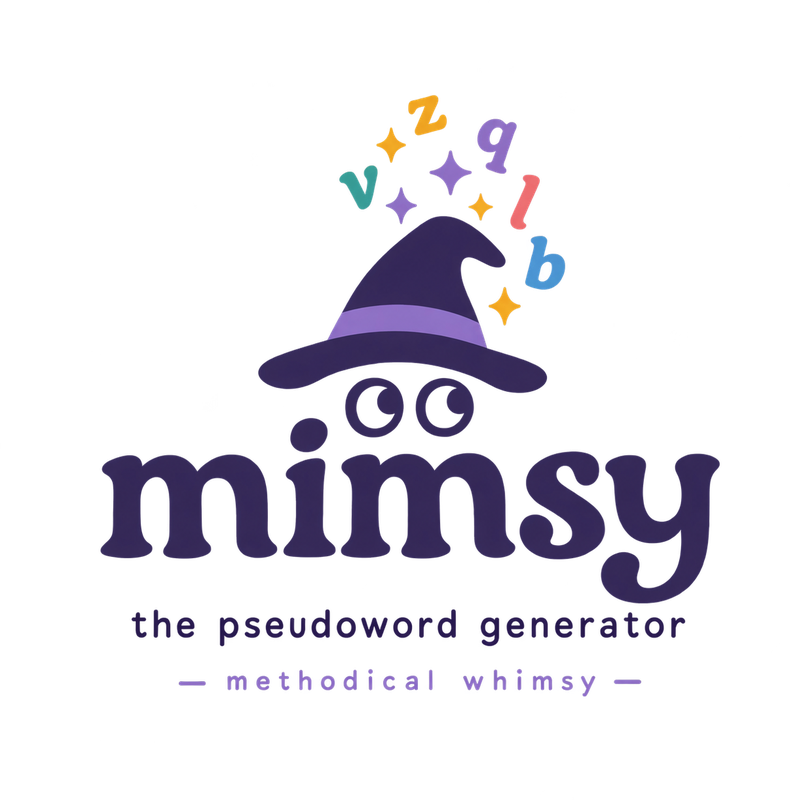

<p align="center"></p>

# Mimsy (beta)

> *All mimsy were the borogoves,*
> *And the mome raths outgrabe.*
> — Lewis Carroll, *Jabberwocky* (1871)

**Mimsy** is a browser tool for finding, generating and checking pseudowords — strings that look and sound like words of a language but are not — in 182 languages. It takes its name from *Jabberwocky*, the most famous pseudoword text in English. For each language it reports the measures that matter when a pseudoword stands in for a real word: length, CV structure, trigram wordlikeness, OLD20, Coltheart's N, embedded words and more.

It is built from the FILMS/OPUS subtitle frequency lists and, for languages with small or unusable subtitle lists or none at all, word lists from the Leipzig Corpora Collection. Version 0.6-beta: about 20.8 million precomputed pseudowords (the main languages have 190,000–385,000 each; small-corpus languages 15,000–120,000).

Mimsy is still in beta.  All feedback is welcome. If you find a bug, please don't hesitate to reach out and let me know.  I especially welcome feedback for many of the smaller langauges, as it was not possible to test most of them with native speakers. 

Email: mimsy.pseudowords@gmail.com


## Using it

**Online:** 

**App:** https://sarachilson.github.io/Mimsy/ — nothing to install; the data is fetched as needed and everything is computed in your browser. Just click the link and get started.

**Offline:**

1. Open `app/index.html` in Chrome, Edge, Firefox or Safari (2023 or newer).
2. Click **Select the data folder** and choose `app/data`. Your files stay on your computer.
3. Pick a language at the top right.

| Tab | What it does |
|---|---|
| Search the bank | Filter the precomputed pseudowords per language by length, CV pattern, letters, distance to the nearest word, OLD20, Coltheart's N and wordlikeness. |
| Match my words | Upload a word list (.txt, .csv, .tsv or Excel; choose the sheet and column) or paste words, and get one pseudoword per word with the same length and CV pattern and a close OLD20 and wordlikeness. Download the original table with the result columns added, as TSV or Excel. Before matching, the app asks before removing punctuation or symbols (with examples), and lists any letters outside the language's alphabet with the CV class they will get (the class of the base letter if it is in the alphabet, e.g. é → e; otherwise a cross-script vowel list; otherwise consonant). Items with digits or more than one word are left unmatched; everything that was changed is recorded in an `input_note` column. |
| Analyze words | CV structure, real-word status and Zipf, IPA, OLD20, N, nearest word and spelling check for any items (typed or uploaded). |
| Cross-language sets | Pseudowords for 2–8 languages at once, matched on length, OLD20, wordlikeness and Coltheart's N within tolerances (see below). |

**Real words of other languages.** The bank, Match and Analyze tabs have a "Real words of other languages" control: choose languages written in the same script (for example English and Dutch while working in German) and every item that is a word there is highlighted, with a "Word in" column naming the language and Zipf. A button then removes the flagged items (bank, Analyze) or replaces each flagged pseudoword by the next-best candidate (Match). You choose which words count (common words with Zipf ≥ 3, all reference words, or every form in the corpus list including rare forms) and whether accents are ignored (cafe = café). The choice applies to all tabs and lasts until the page is reloaded.

Every table can be sorted by clicking a column header and downloaded as CSV.

The `app/lib` folder holds JSZip (MIT), used to read and write Excel files; keep it next to `index.html`.

## Sharing it

- **As a folder:** zip the `app` folder (about 350 MB) and share it, for example on Google Drive. Recipients unzip it and follow the steps above.
- **As a website:** put the `app` folder in a GitHub repository and turn on GitHub Pages. The data then loads automatically, with no folder selection needed.

## Cross-language sets

For cross-linguistic studies the Cross-language sets tab draws pseudowords for several languages at once from each language's whole bank. Two designs:

- **Common window:** every language gets the same number of items, all within the same ranges (length; OLD20, wordlikeness, Coltheart's N and, optionally, rarest trigram, OUP, TL neighbours and embedded-word count as target ± tolerance; optional CV pattern). The length distribution is made identical across languages (per length, the scarcest language sets the quota), and in the wide table each row pairs items of the same length. "Check candidates" shows how many items fit per language before building.
- **Yoked:** for each seed item of a seed language (typed in, or drawn from its bank with the ranges above), every other language gets the closest item within the tolerances (optionally the same CV pattern and a length difference you allow); items are not reused, and the Notes column says when a match falls outside a tolerance.

OLD20 and N can be compared as raw values or, by default, as percentiles within each language and length, because lexicon size and alphabet change raw neighbourhood values a lot across languages (a 225,000-word Tamil lexicon is far denser than a 20,000-word Faroese one, and Hindi akshara strings have much higher raw OLD20 than Latin-script words). Wordlikeness is always a within-language percentile. Lengths are counted in each language's own unit (letters, aksharas, fidel); CV patterns are offered only when all chosen languages have the same script type. Items that are real words in any of the chosen languages (same script) are excluded by default. Seed items can also be uploaded (text, CSV/TSV or Excel, with sheet and column choice). In the results, click any pseudoword to choose another one for that language: in the common window the alternatives stay inside the ranges and have the same length; for a yoked match they are ranked by closeness to the set's seed; choosing a new seed item matches the other languages of that set again automatically. A random seed makes the sets reproducible. Output: long table (one row per item) or wide table (one row per set), a summary of means and SDs per language, CSV and Excel downloads.

## Small-corpus languages

Thirty languages come from small corpora: eight from FILMS_med (Basque, Catalan, Galician, Georgian, Latvian, Spanish (Spain), Tagalog, Welsh; 1–13 million words) and 22 from FILMS_sm (Afrikaans, Aragonese, Armenian, Asturian, Azerbaijani, Belarusian, Breton, Esperanto, Igbo, Irish, Kazakh, Luxembourgish, Mongolian, Northern Sami, Norwegian Nynorsk, Occitan, Portuguese (Mozambique), Scottish Gaelic, Somali, Swahili, Tatar, Uzbek; under 1 million words). For these, frequency values are unreliable, so no frequency bands are offered (all-words generators only), and the app shows a caution banner. Languages with fewer than 5,000 reference words are additionally marked **experimental**: their generators mostly recombine fragments of existing words and results should be treated as illustrative. Both rules are automatic (`small_corpus`, `experimental` in each manifest).

## Leipzig Corpora Collection word lists

For languages whose subtitle list is small (fewer than a few thousand usable words) or corrupted, and for languages with no subtitle list at all, the reference lexicon is extended with the word-frequency list of one corpus from the Leipzig Corpora Collection (CC BY; Goldhahn, Eckart & Quasthoff 2012; `pipeline/get_leipzig.py` downloads them, `_leipzig/leipzig_catalog.tsv` lists the corpus used per language). Rules: the largest corpus available, news preferred over web, Wikipedia only when nothing else exists; words are lowercased, and in cased scripts a word is kept only if it occurs in lowercase at least twice (forms seen only capitalised are names or acronyms); a word becomes a reference word with a corpus count of at least 3 (1M/300K corpora) or 2 (smaller). Where a subtitle list exists the two are merged: subtitle Zipf and IPA for the words it has, a Zipf computed from the Leipzig corpus for the others. Languages built from Leipzig alone (95 of them, from Gujarati and Maltese to Amharic, Dhivehi, Yiddish and Navajo; the full list with per-language decisions is in LEIPZIG_NOTES.md) take all frequencies from that corpus and have no frequency bands; their alphabets were derived from the word lists with `pipeline/derive_alphabet.py` and checked by hand. The About tab and the caution banner say which corpus was used and how many reference words come from each source; written-source vocabulary is more formal than subtitles and contains more names and foreign words.

## Regional varieties (Swiss German, Bavarian, Limburgish, West Flemish, Emilian-Romagnol, Egyptian Arabic)

Six regional varieties of languages that are already in the tool were added on 30 Oct 2026, each from its Wikipedia word list (Leipzig Corpora Collection; 0.6–1.9 million words, 13,000–39,000 reference words). They are treated differently from the other languages because so much of their vocabulary is shared with the standard language (`parents=[...]` in `pipeline/languages.py`):

- **Reject list.** Every word form of the parent language (its reference lexicon and rare forms; German 822k, Dutch 644k, Italian 300k, Arabic 1.15M forms) is added to the variety's reject list at build time, so no pseudoword is a real word of the parent either. The parent's Hunspell dictionary is used in the real-word check as well (it catches inflected forms the parent's corpus missed). Shared words stay in the variety's own lexicon: they are words of the variety too and belong in its letter model and its neighbourhood measures.
- **Pre-selected cross-language check.** When one of these varieties is chosen, the app pre-selects the parent language(s) under "Exclude real words of other languages", so the *Word in* column shows near misses to real German/Dutch/Italian/Arabic words from the start. The user can switch this off like any other cross-language choice.
- **Banner.** The caution banner has an item "Variety of German" (etc.) saying what was done and how many reference words are shared.

| Variety | Parent(s) | Corpus (Leipzig) | Reference words | Shared with parent | Bank | Removed by parent dictionary |
|---|---|---|---|---|---|---|
| Swiss German (gsw) | German | gsw_wikipedia_2021_100K, 1.9M | 24,276 | 5,169 | 72,828 | 71 |
| Bavarian (bar) | German | bar_wikipedia_2021_100K, 1.8M | 24,062 | 3,700 | 72,186 | 32 |
| Limburgish (lim) | Dutch, German | lim_wikipedia_2021_100K, 1.8M | 39,106 | 10,693 / 2,718 | 117,318 | 440 |
| West Flemish (vls) | Dutch | vls_wikipedia_2021_30K, 0.6M | 15,258 | 5,136 | 45,774 | 198 |
| Emilian-Romagnol (eml) | Italian | eml_wikipedia_2021_30K, 0.7M | 13,470 | 1,257 | 40,410 | 45 |
| Egyptian Arabic (arz) | Arabic | arz_wikipedia_2021_100K, 1.3M | 30,361 | 16,262 | 91,083 | 4,585 |

None of these varieties has a fixed orthography (Swiss German Wikipedia mixes Dieth-style and ad-hoc spellings; Bavarian has several competing conventions; Limburgish uses the 2003 Veldeke spelling only in part), so the same word occurs in several spellings and the letter models are correspondingly looser. Egyptian Arabic shares the Arabic letter rules (abjad: CV is orthographic) plus the loan letters ڤ پ چ; Persian-shaped ک and ی were normalised to ك and ي. Six smaller varieties with Leipzig lists were not added (Kölsch, Palatine German, Zeelandic, Extremaduran, Samogitian, Fiji Hindi; Pontic Greek has no list): their lists are tiny and their parent languages' vocabulary would dominate.

## Indic languages (Hindi, Bengali, Nepali, Marathi, Maithili, Newar, Sanskrit, Gujarati, Punjabi, Assamese, Bishnupriya, Odia, Kannada, Tulu, Telugu, Tamil, Malayalam, Sinhala)

These abugidas write a consonant with an inherent vowel that a vowel sign or a virama replaces. CV (orthographic) counts every consonant letter as C plus an inherent V unless a vowel sign or virama follows, vowel letters and signs as V, and anusvara as C (before a consonant in Hindi-type scripts). CV (phonological) applies the schwa-deletion rule (Ohala 1983; Devanagari, Gujarati, Gurmukhi) and, where the subtitle list has pronunciations, a context table learned from them; its held-out accuracy is shown under the CV basis selector (Hindi 93%). Dravidian scripts, Sinhala, Odia, Newar and Sanskrit keep the inherent vowel. Length is counted in aksharas (consonant or vowel letters minus viramas) and the default search length is 2–4. In the subtitle lists for these languages most forms without a pronunciation are corrupted (missing vowel signs), so only pronunciation-attested subtitle words are used, plus the Leipzig words. Script tables are in `pipeline/indic.py`.

## Other scripts

- **Ethiopic (Amharic):** a syllabary; every character counts as CV except the sixth-order characters (bare consonant), length is counted in characters (fidel), default search length 2–4.
- **Thaana (Dhivehi):** vowel marks (fili) count as V, consonant letters as C, sukun as a modifier; length counts letters and fili.
- **Yiddish:** Hebrew script treated as an alphabet (א ע י ו as vowels); **Uyghur:** Arabic script that writes all vowels (ا ە ې ى و ۇ ۆ ۈ as V).
- **Cyrillic minority languages** (Bashkir, Chechen, Chuvash, Buryat, Kyrgyz, Komi, Komi-Permyak, Karachay-Balkar, Meadow and Hill Mari, Erzya, Ossetian, Yakut, Tajik, Tuvan, Udmurt, Rusyn): one shared vowel list; Latin look-alike spellings in the sources were converted to the Cyrillic letters.

## Abjad languages (Arabic, Hebrew, Persian, Urdu, Kurdish (Sorani), Sindhi, Pashto, Punjabi (Shahmukhi), Gilaki, Mazanderani)

These scripts leave most vowels unwritten, so two CV patterns are offered:

- **CV (orthographic):** vowel letters (alif/alef, waw, ya/yod and their variants) count as V, every other letter as C. Diacritics, tatweel and bidi marks are removed first; Persian/Kurdish half-space is a modifier; the Urdu/Shahmukhi/Sindhi aspiration letter ھ and nun ghunna ں count as consonant letters (since 14 Oct 2026; at the grapheme level ھ joins the consonant before it and ں the vowel). Final-form spelling rules are enforced (Hebrew final letters; Arabic ta marbuta and alef maqsura at word end).
- **CV (guessed):** a per-letter model learned from the words that have an IPA transcription (`pipeline/cvguess.py`), inferring where unwritten vowels fall. Its accuracy on held-out words is shown on the About tab (Arabic 47% exact / 64% right vowel count; Persian 51% / 68%; Urdu 52% / 66%). Languages with too few IPA words (Hebrew, Kurdish, Sindhi, Pashto, Punjabi (Shahmukhi), Gilaki, Mazanderani) use a syllable rule only.

A "CV basis" switch on the bank tab chooses which pattern the CV filter and the matching use. Pseudowords themselves are generated, scored and matched on letters (unvocalized surface forms), as in the other languages; for abjads the attested-cluster filter is not applied, because runs of consonant letters are not clusters, and items without vowel letters are allowed.

## Korean (Hangul): jamo as the unit

Korean syllable blocks are decomposed into their jamo (Unicode NFD: initial consonant, vowel, optional final consonant — 19 + 21 + 27 letters), and the jamo are the pipeline's letters, as in Korean psycholinguistics: 한 is 3 letters, 안녕 is 6. Length, OLD20, Coltheart's N (one jamo exchanged, added or removed), the n-gram models and the trigram wordlikeness count jamo; a *Syllables* column gives the block count. Initial ㅇ is a silent place-holder, so it counts as a letter but not in the CV pattern (안 = VC, 한 = CVC); compound vowels (ㅘ, ㅢ) and double finals (ㄳ, ㄺ) are single jamo. Generated jamo strings are kept only if they recompose into syllable blocks (`hangul_ok`); the app shows them recomposed and decomposes typed Hangul. Data: the FILMS Korean subtitle list (1.88 M forms, 165 M tokens) plus the Leipzig kor_news_2022_1M list; Korean word forms are *eojeol* (stem + particles/endings), so the reference lexicon (405,000 forms) and the pseudowords carry real endings (-의, -을, -어요), exactly as the subtitle forms do. Cross-language sets work with Korean, with its own unit (jamo).

## Thai: letters, vowel signs and tone marks

Thai writes no spaces, so its word lists come from automatic segmentation (the FILMS subtitle list, 225,000 Thai-script forms, 289 M tokens, and the Leipzig tha_newscrawl_2011_100K list, which contains some phrases); 70,000 reference words. Letters are counted as written (consonants, vowel signs, tone marks). Letter classes: 44 consonants C (including อ ว ย, which also serve as vowels), vowel signs above/below and spacing vowels V, the pre-posed vowels เ แ โ ใ ไ a class of their own (`P`: written before the consonant, placed after it in the CV string), tone marks, maitaikhu and thanthakhat modifiers that are skipped in CV. Implied vowels (กด = /kot/) are unwritten, so, as for the abjads, consonant-only strings are legal and the attested-cluster filter is not applied; *CV (phon.)* comes from the IPA-trained table (`cvguess.py`, 8,600 words with IPA). Generated strings must follow the writing rules (`thai_ok`, mirrored in the app): marks sit on a consonant, at most one vowel sign and one tone mark per consonant with the vowel sign first, pre-posed vowels followed by a consonant, ั and ็ by a final consonant, no word starting with a mark or ending in a pre-posed vowel. Because Thai morphemes are mostly monosyllabic, many longer items are novel compounds of real syllables (the Embedded-words column shows them).

## Chinese (Mandarin, pinyin): syllables as the unit

Mandarin has only about 400 base syllables (1,187 with tone in our data), and almost every legal syllable is a real morpheme, so a letter model over pinyin would produce either illegal syllables or real ones. Chinese pseudowords are therefore **sequences of real toned syllables that do not form a word** — the stimulus type used in Mandarin auditory lexical decision — and the pipeline's "letters" are toned syllables:

- `pipeline/make_pinyin.py` turns the FILMS zh_CN subtitle list (1.19 M character strings, 174 M tokens) into pinyin with pypinyin (MIT; phrase dictionary first, then per character; 不 and 一 with their citation tones; neutral tone written without a mark), merges homophones (same toned syllables: frequencies added; the most frequent character form is kept for display), and maps every toned syllable that occurs in at least three reference-eligible words to one Private Use Area character (U+E000 …). The symbol table is `pipeline/syllables_zh.json` and is copied into the manifest.
- `build_bank.py` then runs unchanged (`script="syllables"`; `pipeline/syl.py`): the Kneser-Ney model is a syllable 3-gram (`order=3`; only the KN generator is built, because plain trigrams over syllables reproduce real words), items are 2–4 syllables long (two-syllable items are oversampled to half of each set, since most syllable pairs are words), every syllable is legal so only the length and no-triple rules apply, and the reject list holds every pinyin form of the corpus (828k, including 722k rare ones). Length, OLD20, Coltheart's N (one syllable exchanged, added or removed), the nearest word and the trigram wordlikeness all count syllables. CV is the orthographic CV of the pinyin letters of each syllable in turn (zh/ch/sh/ng one C; y, w as C; every vowel letter V): zhōng = CVC, xiǎo = CVVV. The neighbour kernel (`neighbors.c`) now takes 16-bit symbols, so alphabets of more than 255 units work.
- The app shows the symbols as pinyin with tone marks (an apostrophe before a vowel-initial syllable, as in pinyin orthography), the nearest word with its characters, and accepts in Analyze, Match and the search filters pinyin with tone marks (zhōngguó), tone numbers (zhong1 guo2, zhong1guo2; 5 or no digit = neutral tone) or Chinese characters for words of the lexicon. A Tones column gives the tone pattern (1-4; 5 = neutral). Measures that are constant or trivial at the syllable level are not shown for this language: every syllable is a word, so Embedded words and OUP say nothing; the nearest word is always one syllable away (Dist., and OLD20 pct for two-syllable items); transposed-syllable neighbours and the rarest bigram carry no information. There is no real-word check beyond the corpus list (no Hunspell dictionary applies), and no graphemic or phonological CV. Chinese is not offered in Cross-language sets (its measures count syllables, not letters) and has no "Exclude real words of other languages" partners (no other language shares its unit).

- **Two item types.** Every Mandarin syllable is a morpheme, so items made of real syllables are *novel compounds* — the standard nonword type in Mandarin auditory lexical decision (e.g. Chien, Sereno & Zhang 2015 built their targets as two legal monosyllables whose combination is not a word). The second type, *tonal-gap* items, contains one of the 334 legal syllables that never carry a given tone (xǐn, bú, cé …; cf. Sharma, Li & Maggu 2025): a syllable that is no morpheme at all, offered alone (length 1, 334 items) or with one real syllable drawn by frequency (20,000 items; generator name `gap`). The *Item type* filter on the bank tab separates them.
- **Syllable measures.** *Syllable Zipf* is each syllable's token frequency summed over all words containing it (mean, with the per-syllable values in brackets); *Homophones* is the number of distinct characters read with that toned syllable in the reference words (homophone density); *Tones* is the tone pattern. All three are computed by `make_pinyin.py` from our own data and stored in the symbol table.

Not built: *pseudo-compounds* (two real characters that do not form a word, the usual visual pseudoword type for Chinese reading research) — a different stimulus type, possible from the same data but outside a sound-based tool for now.

## Graphemes: three CV levels

Every alphabetic language has up to three CV patterns, chosen with the "CV pattern basis" switch on the bank tab (it also drives "CV structure" in Match my words and the CV pattern in Cross-language sets):

- **CV (orth.)**: one letter = one unit. Letters are classed as consonant or vowel per language; modifier characters with no sound of their own (Cyrillic ь ъ, Catalan ·, apostrophes, ZWNJ) are skipped.
- **CV (graph.)** and **Graphemes**: a grapheme is the smallest letter group that spells one sound, so multi-letter graphemes (English *sh*, *ea*; German *sch*, *ei*; Hungarian *dzs*; Zulu *ngc*; Urdu *گھ*) and doubled letters count as one unit, and the Graphemes column counts them. Reading research treats letter length, grapheme complexity and phoneme structure as separate levels (Rey, Ziegler & Jacobs 2000; Schmalz, Marinus, Coltheart & Castles 2015; Borleffs et al. 2017), so stimuli matched on letters alone can differ in grapheme count.
- **CV (phon.)**: pronunciation-based, where a model exists (abjads, Indic scripts).

The inventory is in `pipeline/graphemes_src.json` (one entry per language: `status` ok/none/exclude, `multigraphs` with class C or V, optional context `before`/`not_final`, the `doubles` rule, known ambiguities, notes, confidence and sources). `python3 pipeline/graphemes.py app/data` validates it against each alphabet and writes `app/data/graphemes.json`, which the app reads; `pipeline/graphemes.py` also holds the reference tokeniser (longest listed multigraph first, then a doubled letter as one grapheme when `doubles` is "one", then one letter; modifier characters join the preceding grapheme). The About tab of every language lists its multigraphs, the rule for doubled letters, known ambiguities (longest match is applied without exception, which is right for pseudowords and occasionally wrong for real words across morpheme boundaries, e.g. *pothole*) and the sources. Abugidas and the Ethiopic syllabary have no separate grapheme level: the akshara/fidel is the grapheme, so CV (graph.) equals CV (orth.) and is not shown. Languages whose orthography has no multi-letter graphemes get the level only for doubled and modifier letters.

The inventories were compiled from orthography descriptions (Wikipedia orthography articles, Omniglot, academic grammars and the epitran grapheme-to-phoneme maps as a cross-check) and checked against each language's word list; `_graphemes/` in the working folder holds the research files and the check script. Judgement calls are recorded per language in the notes.

## Method (summary)

- **Filters:**
  - no form found anywhere in the corpus list;
  - 3 to 12 letters long;
  - every initial, medial and final consonant cluster and every vowel sequence occurs in at least 3 reference words;
  - no triple letters;
  - extra spelling rules for some languages: vowel harmony (Finnish, Turkish), a single stress accent (Spanish, Portuguese, Italian, Greek), Greek final sigma, and Vietnamese single syllables.
- **Measures:**
  - OLD20 (Yarkoni et al., 2008) and Coltheart's N, exact, computed against reference words with Zipf ≥ 2;
  - nearest word, its edit distance and its Zipf;
  - wordlikeness: mean log10 trigram frequency from the reference lexicon (word boundaries included; type or token counts, switchable in the app), shown as a percentile among the language's real words of the same length; the Kneser-Ney model log-probability is kept as a secondary column;
  - embedded word: the longest reference word (3+ letters) inside the item and its position, with optional filters.
  - added 14 Oct 2026, computed in the app on demand: **rarest trigram** (the item's least frequent trigram on the same scale as trigram frequency, with the trigram shown in brackets: a weakest-link measure the mean hides); **OUP**, the orthographic uniqueness point (Kwantes & Mewhort 1999: the first letter position at which the item stops matching the beginning of any real word; "n+" when the whole item begins a real word); **TL neighbours** (Perea & Lupker 2004: real words formed by swapping two adjacent letters, e.g. jugde → judge); **embedded words**, the number of distinct real words of 3+ letters inside the item (Bowers, Davis & Hanley 2005); only words at or above a Zipf threshold count (default 3 = one per million, the usual low/high-frequency boundary of van Heuven et al. 2014; 2 or 4 selectable under the embedded-word filter, which uses the same threshold); clicking the number lists them with their positions (this replaces the former "Embedded word" column; the longest one is still in the Match download). All four appear in the bank, Analyze and Match tables (for the word and its pseudoword), can be used as optional matching criteria with a tolerance (Match on), and are in the Match downloads (word_/pseudo_ columns oup, tl_neighbours, min_trigram, n_embedded).
- Settings for each language are in `app/data/<language>/manifest.json`.

## Rebuilding the data

`pipeline/build_bank.py` rebuilds everything from the slim word lists in `_slim/`, which are four columns taken from each language's `*.word.pron-one_col-default.filtered_by_pron[.spell_checked].zipf_4.tsv` file in `FILMS_data.zip`, `FILMS_med.zip` or `FILMS_sm.zip` (eight languages without a FILMS spell checker have no `spell_checked` in the name). `pipeline/films_files.json` records the exact archive and file per language; the About tab shows it. It needs Python 3 with numpy and gcc.

```
cd pipeline
python3 build_bank.py                     # all languages (3–4 hours; resumable, rerun to continue)
python3 build_bank.py --lang english-en   # one language
python3 verify_metrics.py english-en 20   # brute-force check of the metrics
python3 make_pinyin.py <FILMS chinese_mainland_china.zh_CN.word.raw.tsv>   # Chinese: writes _slim/chinese_pinyin-zh.tsv.gz and syllables_zh.json (needs pypinyin)
```

Language settings (alphabets, vowels, the rule for `y`, spelling rules) are in `pipeline/languages.py`; `pipeline/derive_alphabet.py <corpus>` prints the letter inventory of a Leipzig list for a new entry; `pipeline/get_leipzig.py` downloads the lists.

## Morphology (pilot: Kazakh)

Agglutinative languages inflect freely, so a frequency list never contains all the real forms, and a generator trained on surface forms produces items that are themselves real words (кітаптарымыз-style forms the corpus happened to miss) or real stems with real suffixes. Since 29 Oct 2026 Kazakh has a morphology layer built with the Apertium Kazakh transducer (apertium-kaz; Washington, Salimzyanov & Tyers 2014) compiled with HFST (Lindén et al. 2011); `pipeline/morph.py` does three things:

- **Real-form rejection.** Every bank item is run through the full analyser; anything it accepts is a real word form and is removed from the bank when the language loads (Kazakh: 7,999 of 120,000 items, 6.7%, including imperatives such as тіре and plural/possessive/case forms). The About tab reports the count.
- **Morphology labels** for every remaining item, from a "guesser" transducer whose stem lexicon accepts any letter string, with the full phonology re-imposed by regenerating each parse: *affixed* (unknown stem + legal affix chain, e.g. дұғыр·лар·ының n.pl.px3sp.gen), *bare* (no affixes), *real stem* (a real stem with an affix chain the analyser rejects). The bank gets three new columns — **Morphology** (stem·suffixes with the tags), **Affixes** (count) and **Harmony** (front/back/mixed vowel harmony; a label, not a filter, because about a tenth of real Kazakh words — loans, compounds, invariant suffixes — are mixed) — and a **Morphology** filter (any / affixed / bare / real stem / generated; affix count range; harmonic only). Analyze shows the same for a typed item ("real form" when the analyser accepts it).
- **Morphology-matched generation.** A new generator `morph` builds pseudo-stems with a Kneser-Ney letter 4-gram trained on the analysed stems of Zipf ≥ 3 words (vowel-harmonic, 2–8 letters, not a real stem), draws a real affix chain with its lexicon frequency, and inflects the pair through the transducer, so suffix allomorphy (-лар/-лер/-дар/-дер/-тар/-тер, possessive and case forms) comes out right; 20,000 such items are appended to the Kazakh bank (`bank_morph.tsv.gz`, generator "morph"). In Match, **Same affix chain as the word** restricts candidates to pseudowords with exactly the word's affix chain (кітаптарымыз → a pseudoword with n.pl.px1pl.nom), using the analyses of 87,143 of the 106,571 reference words (`lex_morph.tsv.gz`).

To rebuild: compile the transducers as described in `pipeline/_morph/README.md` (the compiled `.hfstol` files for Kazakh are in the repository) and run `python3 pipeline/morph.py kazakh-kk --tools <hfst bin dir>` (about 1.5 minutes). Adding another language needs an Apertium transducer with a guesser (Turkish, Kyrgyz, Tatar, Kumyk, Finnish and others have one) and an entry in `MORPH` in `morph.py`.

## Real-word check (dictionaries, UniMorph, Bible texts)

A frequency list only contains the forms that happened to occur in the corpus. A letter model trained on it therefore produces some items that are real words anyway — inflected forms the corpus missed, rarer words — and the problem is worst in the small Wikipedia-only languages, whose lists are tiny. Since 30 Oct 2026 every bank is also checked offline against sources built to be complete rather than frequent (`pipeline/realwords.py`); the hits are written to `app/data/<language>/realwords.tsv.gz` and the app drops those items when the language loads. The About tab reports the count and the sources, and the Analyze tab flags a typed item found this way as "real word (spelling dictionary / UniMorph / Bible text)".

- **Hunspell spelling dictionaries** (the LibreOffice/Firefox dictionaries, collected in `wooorm/dictionaries`, `LibreOffice/dictionaries` and `elastic/hunspell`; 92 of our languages have one). A dictionary is a stem list plus affix rules, so it accepts inflected forms it has never seen written. Compounding rules are switched off (with them on, Estonian accepted 28% and Danish 11% of the bank — any two glued words — against 4% and 1% without), both the lower-case and the capitalised spelling are tried, and a dictionary is used only if it recognises at least half of the language's own reference words (otherwise it is too small or in another orthography: skipped for Odia, Punjabi, Azerbaijani, Kinyarwanda, Guarani, Hausa, Telugu, Tamil, Kannada, Armenian, Gujarati, Low German, Ligurian, Kurdish, Assamese and Kazakh).
- **UniMorph** inflection tables (github.com/unimorph; 96 of our languages): every lemma and inflected form counts as a real word. Small gain in most languages (under 1%), larger for Tuvan, Finnish, Yakut, Quechua, Northern Sami.
- **Bible translations**, for the small-corpus languages only (the same < 20 million-word threshold as the app's "small corpus" caution; in the big languages the old translations only add archaic spellings). Texts from the eBible corpus (github.com/BibleNLP/ebible) and the christos-c/bible-corpus collection; a token counts if it occurs at least twice, every character belongs to the language's lexicon and, in cased scripts, it occurs in lower case at least once (names are left out). Bible words that are not in the language's lists are kept in the same file ("bible-extra") so that Analyze can flag them; they are not used for distances or wordlikeness.

The per-language dictionary, licences and counts are in `pipeline/realwords_sources.json` and in each manifest under `realword_filter`. The dictionaries and texts themselves stay offline (about 3 GB); nothing is added to the app beyond the small `realwords.tsv.gz` files. A Kazakh cross-check shows how partial each source is: the Hunspell dictionary and the Apertium analyser each flag about 8,000 items, but only 3,000 are the same items — so the check is a safety net, not a guarantee, and a native speaker's look at the final items remains advisable for the small languages.

To rerun: clone the three dictionary collections, the UniMorph repositories and the two Bible corpora, then `python3 pipeline/realwords.py --hunspell <dir with wooorm/, libreoffice/, elastic/> --unimorph <dir> --ebible <dir> --bible <dir>` (needs libhunspell; about 20 minutes for all languages).

## Known limitations

- CV structure and models are based on letters, not graphemes or sounds (for example, English "sh" counts as CC).
- Morphology is checked only for Kazakh so far (see above); in the other languages items can contain real affixes, and the real-word check (dictionaries, UniMorph, Bible texts) is only as complete as those sources — 81 languages, mostly the small Wikipedia-only ones, have no dictionary at all (the six regional varieties use their parent language's dictionary).
- Chinese (pinyin) items are syllable sequences: the reject list is the corpus list only, and pinyin from pypinyin can be wrong for rare heteronyms (characters with several readings).
- Vietnamese has a small search space (about 18,000 legal syllables, fewer than the targets), and most short syllables are one edit from a real one.
- Bank sizes: each generator and training set gets as many pseudowords as the set has training words, between 5,000 and 40,000 (see `generation` in each manifest).

## Citation

All word lists and frequencies come from two data resources; cite the one(s) used for the languages in your study (the About tab says which a language uses):

- **FILMS:** Chilson, S., Sineva, E., & Schmalz, X. (2024). FILMS: A multilingual word frequency corpus based on film subtitles with IPA transcriptions. OSF Preprints. https://doi.org/10.31219/osf.io/zy5qf
- **Leipzig Corpora Collection:** Goldhahn, D., Eckart, T., & Quasthoff, U. (2012). Building large monolingual dictionaries at the Leipzig Corpora Collection: From 100 to 200 languages. In *Proceedings of LREC 2012* (pp. 759–765).

Please also give this tool's version. SOURCES.md lists the methods literature behind the measures and generators.
